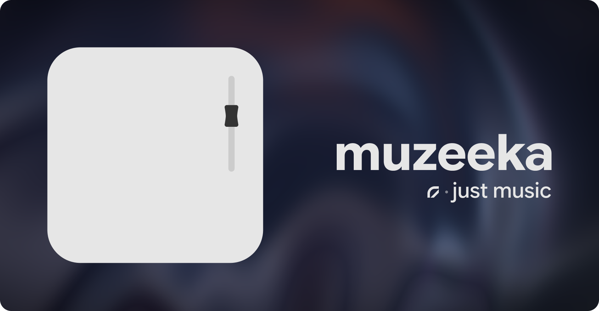

The app is currently in the process of transitioning from WebView to native code.

> **Status:** early beta.  
> It works, but expect rough edges, incomplete features and occasional weirdness. 

## What is it?

muzeeka is a desktop audio player focused on local library playback, playlist management, and a polished UI.

**Supported platforms:** Windows only (for now).

## Features

- Local library with folder scanning, metadata & cover art
- Playlists (create, reorder, custom covers, liked tracks)
- Gapless playback
- Equalizer with custom presets
- Synchronized lyrics (LRC/TTML) + fullscreen lyrics view
- Search, drag-and-drop, context menus
- Download audio via yt-dlp and from VK
- Discord Rich Presence
- Built-in remote control over local network
- Playback speed control with optional pitch correction
- CUE sheet support
- Frameless modern UI with fullscreen player

## Acknowledgements

muzeeka depends on a number of great projects and libraries:

- [BASS](https://www.un4seen.com/) - the core audio playback engine
- [FFmpeg](https://ffmpeg.org/) - multimedia processing and conversion
- [yt-dlp](https://github.com/yt-dlp/yt-dlp) - media extraction capabilities
- [Deno](https://deno.com/) - JavaScript runtime used alongside yt-dlp
- [GPUI](https://github.com/zed-industries/zed) - the GPU-accelerated UI framework from Zed
- [Rust](https://www.rust-lang.org/) - systems language powering the whole application
- [windows](https://crates.io/crates/windows) - Windows API bindings
- [Google Sans](https://fonts.google.com/specimen/Google+Sans) - font used by the app
- [better-lyrics](https://github.com/better-lyrics/better-lyrics) - the word-sync lyric animation is ported from its `@braccato/core` engine (MIT)
- [tokio](https://crates.io/crates/tokio) - async runtime
- [crossbeam-channel](https://crates.io/crates/crossbeam-channel) - multi-producer channels
- [parking_lot](https://crates.io/crates/parking_lot) - faster synchronization primitives
- [libloading](https://crates.io/crates/libloading) - dynamic loading of BASS libraries
- [serde](https://serde.rs/) - Rust serialization framework
- [serde_json](https://docs.rs/serde_json/) - JSON handling in Rust
- [lofty](https://crates.io/crates/lofty) - audio metadata parsing
- [id3](https://crates.io/crates/id3) - ID3 tag support
- [cue-rw](https://crates.io/crates/cue-rw) - CUE sheet parsing
- [encoding_rs](https://crates.io/crates/encoding_rs) - text encoding detection and conversion
- [walkdir](https://crates.io/crates/walkdir) - recursive folder scanning
- [rayon](https://crates.io/crates/rayon) - parallel iteration in Rust
- [image](https://crates.io/crates/image) - image decoding and processing
- [rusqlite](https://crates.io/crates/rusqlite) - SQLite access
- [ureq](https://crates.io/crates/ureq) - HTTP client
- [regex](https://crates.io/crates/regex) - regular expressions
- [discord-rich-presence](https://crates.io/crates/discord-rich-presence) - Discord Rich Presence integration
- [Unison](https://unison.boidu.dev) - Lyrics from Unison

## Legal & Third-Party Notices

muzeeka integrates several powerful third-party libraries and CLI tools to handle media playback and extraction. These tools are governed by their own respective licenses:

- **[BASS Audio Library](https://www.un4seen.com/)**: Audio playback is powered by the BASS library. BASS is a product of Un4seen Developments Ltd. It is free for non-commercial use. If you intend to distribute or use muzeeka commercially, you must obtain a separate commercial license from Un4seen Developments.
- **[FFmpeg](https://ffmpeg.org/)**: This software uses the code of FFmpeg to handle audio processing, licensed under the LGPLv2.1 / GPLv3. FFmpeg is a trademark of Fabrice Bellard, originator of the FFmpeg project.
- **[yt-dlp](https://github.com/yt-dlp/yt-dlp)**: Used for media extraction. Released into the public domain (Unlicense).

## License

This project is licensed under the MIT License. See [LICENSE](LICENSE) for the full text. 

*Note: The MIT license applies only to the source code of muzeeka itself, not to the pre-compiled third-party binaries (such as BASS or FFmpeg) required to run the application.*
